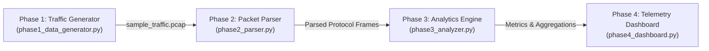

# 5G PCAP Analyzer & Protocol Intelligence Engine

An end-to-end packet processing and telemetry pipeline designed for 5G subscriber and IP traffic analysis. The pipeline synthesizes multi-subscriber network traffic, parses packet headers using deep packet inspection (DPI), calculates statistical telemetry and bandwidth consumption via Pandas, and visualizes KPIs through an interactive Streamlit and Plotly dashboard.

---

## Architecture Overview

The system operates across a modular four-phase sequential pipeline:



---

## Pipeline Components

### Phase 1: Synthetic Traffic Generator (`phase1_data_generator.py`)
* Synthesizes realistic IP packet streams representing multiple User Equipment (UE) subscriber endpoints.
* Simulates standard TCP (HTTP/Video streaming) and UDP (DNS/Voice/Gaming) transport layer distributions.
* Injects randomized payload sizes (64 to 1400 bytes) and inter-packet arrival times.
* Serializes generated frames into standard PCAP binaries (`sample_traffic.pcap`) for downstream ingestion.

### Phase 2: Packet Ingestion and Protocol Parser (`phase2_parser.py`)
* Dissects raw packet capture streams using Scapy's packet dissection engine.
* Filters IP network layers and parses transport protocols (TCP and UDP).
* Normalizes packet metadata, including timestamps, IP source/destination pairs, transport layer ports, and payload lengths into structured dictionary records.

### Phase 3: Statistical Telemetry Engine (`phase3_analyzer.py`)
* Ingests parsed frame dictionaries into Pandas DataFrames for high-performance vectorized operations.
* Converts POSIX epoch timestamps to datetime objects for temporal resampling.
* Computes critical network telemetry metrics:
  * Bandwidth consumption per subscriber IP (`get_bandwidth_per_ip`)
  * Protocol distribution ratios (`get_protocol_distribution`)
  * Throughput time-series and traffic spikes aggregated by second (`get_traffic_over_time`)

### Phase 4: Interactive Telemetry Dashboard (`phase4_dashboard.py`)
* Web-based monitoring application powered by Streamlit and Plotly.
* Real-time Key Performance Indicator (KPI) metrics cards:
  * Total Processed Bandwidth (KB)
  * Total Frame Count
  * Unique Subscriber Endpoint Count (UEs)
* Interactive visual components:
  * Subscriber Bandwidth Distribution (Plotly Bar Chart)
  * Transport Layer Protocol Breakdown (Plotly Donut Chart)
  * Temporal Traffic Spike Tracking (Plotly Area Chart)
  * Expandable raw frame data inspection table

---

## Directory Structure

```
5g-pcap-analyzer/
|-- phase1_data_generator.py   # Synthetic traffic generation engine
|-- phase2_parser.py           # Protocol dissector and packet parser
|-- phase3_analyzer.py         # Statistical analytics and KPI engine
|-- phase4_dashboard.py        # Streamlit & Plotly interactive dashboard
|-- sample_traffic.pcap        # Baseline packet capture dataset
|-- requirements.txt           # Project dependencies
|-- .gitignore                 # Exclusion rules for virtualenvs, caches, and dumps
|-- LICENSE                    # MIT License
`-- README.md                  # Project documentation
```

---

## Prerequisites

* Python 3.9 or higher
* Wireshark / TShark (optional, for external PCAP inspection)

---

## Installation

1. Clone the repository:
```bash
git clone https://github.com/aydanaydemir/5g-pcap-analyzer.git
cd 5g-pcap-analyzer
```

2. Initialize and activate a virtual environment:

**Linux / macOS:**
```bash
python3 -m venv venv
source venv/bin/activate
```

**Windows (PowerShell):**
```powershell
python -m venv venv
.\venv\Scripts\Activate.ps1
```

3. Install required dependencies:
```bash
pip install --upgrade pip
pip install -r requirements.txt
```

---

## Execution Guide

Each pipeline module can be executed independently:

### 1. Generate Synthetic PCAP Data
```bash
python phase1_data_generator.py
```
*Generates `sample_traffic.pcap` with 500 synthesized multi-subscriber IP frames.*

### 2. Parse Packet Capture
```bash
python phase2_parser.py
```
*Dissects network headers and validates packet parsing output.*

### 3. Run Statistical Telemetry Analysis
```bash
python phase3_analyzer.py
```
*Outputs console-based summaries of subscriber bandwidth, protocol breakdown, and temporal throughput.*

### 4. Launch Interactive Web Dashboard
```bash
streamlit run phase4_dashboard.py
```
*Opens the interactive monitoring dashboard in your default browser at `http://localhost:8501`.*

---

## Author

**Aydan Aydemir**
* GitHub: [@aydanaydemir](https://github.com/aydanaydemir)

---

## License

This project is licensed under the MIT License. See the [LICENSE](LICENSE) file for details.
